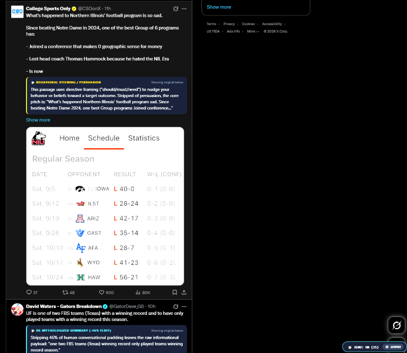

# Xeno-Lens

**Epistemic De-Mythologizer for the Web**

Version 7.5.0

Xeno-Lens is a browser extension for Chrome, Edge, and Brave. It reads the posts, comments, and articles on the page you're looking at (X, Reddit, news sites, and most other pages) and adds a small card under each block of text. The card strips the writing down to what it actually says.

"De-mythologizer" means taking away the framing, spin, and emotional language so you can see the claim underneath and judge it on its own.


<!-- TODO: add a screenshot at docs/screenshot.png -->

## What it does

Xeno-Lens has two modes. Local mode is always on. LLM mode is optional.

**Local mode (no API key, nothing leaves your browser)**

For each block of text, the extension runs word-level statistics in the page:

- Shannon entropy of the words in the block
- Surprisal of each word compared with the rest of the text on the page, weighted TF-IDF style, to find the high-information terms
- Yule's K, a measure of how varied the vocabulary is
- Lexical density

From those it shows the most information-dense sentence in the block (the "central clause"), the top high-information terms, and the raw numbers.

**LLM mode (optional, needs an API key or a local Ollama model)**

When a block scrolls into view, its text is sent to the model you pick. The model returns:

- **Claim:** the core statement with the spin removed, in one sentence
- **Motive:** the writer's likely reason for writing it (persuading, signaling, selling, and so on)
- **Confidence:** a 0 to 1 score of how much of the text is checkable fact compared with rhetoric
- **Archetype:** a 2 to 4 word label for the kind of writing

The model is asked for structured JSON. If the reply comes back broken or cut off, the extension repairs it where it can. Requests go through a queue in the background worker that slows down and backs off when a provider returns a rate limit (HTTP 429), so fast scrolling on X or Reddit doesn't flood the API. Results are cached for the browser session.

## Supported LLM providers

- Google Gemini (the default; default model `gemini-2.5-flash`)
- OpenAI
- Anthropic (default model `claude-3-5-haiku-latest`)
- xAI (Grok)
- OpenRouter
- Groq
- Ollama, running locally at `http://localhost:11434`

You can fetch the list of models from the provider inside the settings panel, or type a model name.

## Install

The extension isn't in a web store yet, so you load it in developer mode.

1. Clone this repo or download it as a ZIP and extract it.
2. Open your browser's extensions page:
   - Chrome: `chrome://extensions/`
   - Edge: `edge://extensions/`
   - Brave: `brave://extensions/`
3. Turn on **Developer mode**.
4. Click **Load unpacked** and choose the folder that contains `manifest.json`.
5. Pin Xeno-Lens to the toolbar if you want quick access.

After you install or reload it, Xeno-Lens injects itself into tabs that are already open, so you don't have to refresh them.

## Using it

- A small control bar sits at the bottom right of each page.
  - The XENO button turns the lens on or off and shows how many blocks it has decoded.
  - **MODE** switches between split (card under the original text) and replace (card in place of the text). Click a card's **Toggle Source** to see the original again.
  - The gear button opens settings.
- Clicking the Xeno-Lens icon in the toolbar also turns the lens on or off for that tab.

## Setting up LLM mode

1. Click the gear button on the control bar.
2. Pick a provider.
3. Paste your API key. For Ollama, leave the key blank.
4. Click **Query Models** to load the model list, or type a model name.
5. Save. Cards on the page will update with the model's answer.

**Ollama note:** By default Ollama may reject requests that come from a browser extension. If you get errors, start Ollama with extension origins allowed, for example:

```bash
OLLAMA_ORIGINS="chrome-extension://*" ollama serve
```

## Permissions and why it needs them

- **`<all_urls>` host access and content scripts on all http/https pages:** the extension has to read text on whatever page you're on, and the background worker has to be able to call the LLM provider you choose (including Ollama on localhost).
- **`activeTab`, `tabs`, `scripting`:** used to toggle the lens from the toolbar and to inject the script into tabs that were already open when you installed it.
- **`storage`:** saves your settings and API key, and caches results for the session.

## Privacy

- In local mode, nothing is sent anywhere. All analysis happens in your browser.
- In LLM mode, the visible text of each block (up to 1,600 characters) is sent straight from your browser to the provider you picked, using your own API key. There is no Xeno-Lens server in between. That provider's privacy policy applies to what you send.
- If you use Ollama, text only goes to your own machine.
- Your API key is saved in the extension's local storage (`chrome.storage.local`) on your computer. It is not encrypted, so don't use this on a shared browser profile with a key you care about.
- The lens is on by default for every page you visit. Turn it off from the control bar or the toolbar icon on sites where you don't want it, especially if you have an API key set.

## Tech

- Manifest V3 browser extension, plain JavaScript, no build step
- Background service worker for provider calls, rate limiting, and caching
- Content script that finds text blocks, including inside Shadow DOM, and draws the cards

## Contributing

See [CONTRIBUTING.md](CONTRIBUTING.md).

## License

MIT. See [LICENSE](LICENSE).
